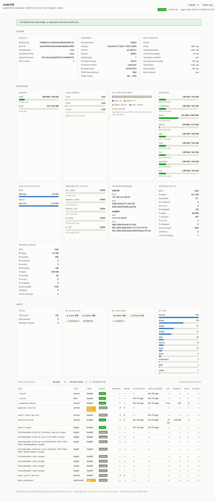
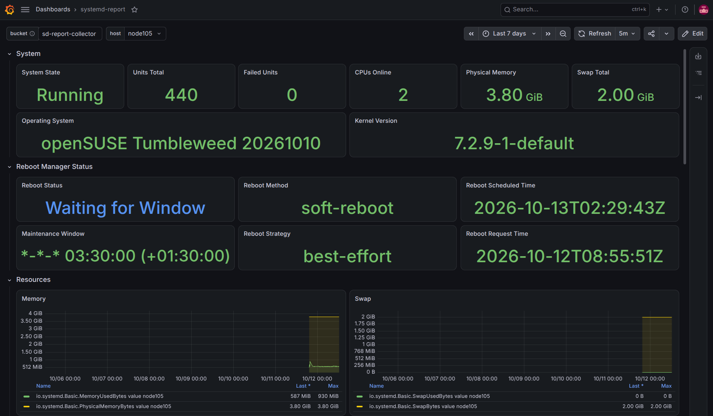
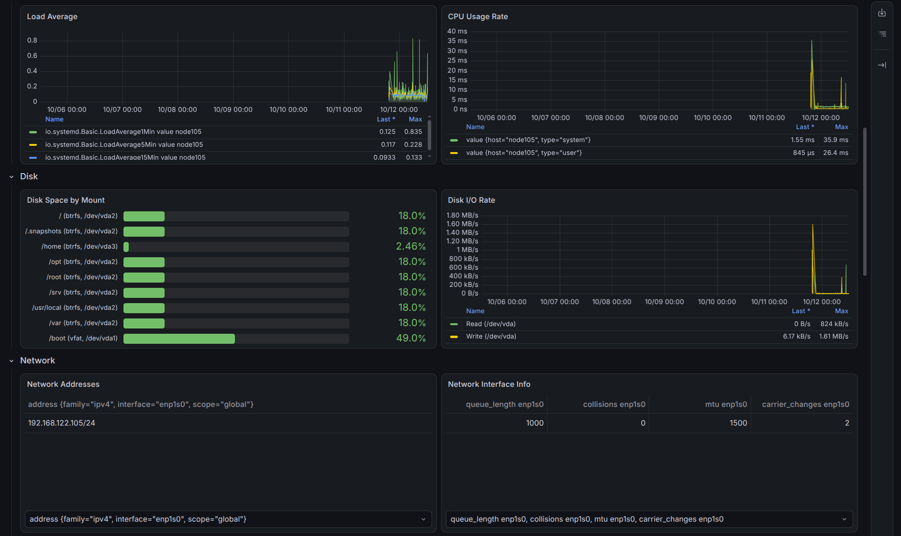
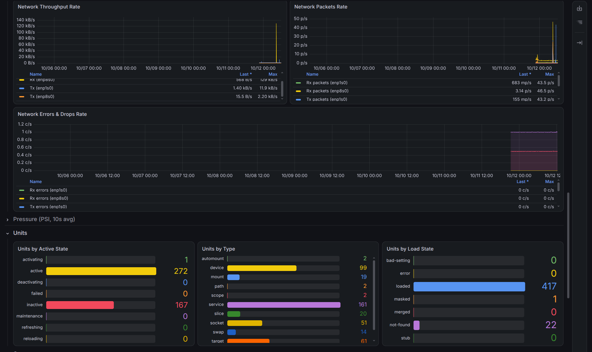

# sd-report-collector

Server counterpart to `systemd-report upload`
(see [systemd-report](https://manpages.opensuse.org/systemd-report.1)).
Accepts report pushes over mTLS, stores each one zstd-compressed under a
per-hostname directory, and runs configured plugins against the saved file.

## Build

Requires only a Go toolchain; configuration parsing uses libeconf's native
Go package, with no cgo or C library dependency.

```
meson setup build
meson compile -C build
meson test -C build
sudo meson install -C build
```

## Quickstart for localhost only

Setting up sd-report-collector with the collector host and the client on a
single machine.

### Collector Host

Generate the CA, the server certificate, and a client certificate under
/etc/sd-report-collector and start the service. The client certificate is named
after the machine's hostname, which is what `sd-report-collector-node.service`
looks for:

```sh
sudo sd-report-certs init
sudo sd-report-certs client "$(hostname)"

sudo systemctl start sd-report-collector.service
```

### Client

systemd-report has to be installed (package systemd-experimental)

Call `systemd-report` manually:

```sh
sudo /usr/lib/systemd/systemd-report upload --url=https://localhost:8443/report --cert=/etc/sd-report-collector/clients/$(hostname).pem --key=/etc/sd-report-collector/clients/$(hostname).key --trust=/etc/sd-report-collector/ca.pem
```

Or use the provided timer and service to run `systemd-report` regularly. Their
defaults already point at `localhost`, so nothing needs to be configured:

```sh
sudo systemctl enable --now sd-report-collector-node.timer
```

You can check the upload in the collector's journal:

```sh
sudo journalctl -u sd-report-collector.service -f
```

With SELinux in enforcing mode, the timer fails until the policy module
described in [SELinux](#selinux) is installed.

## Quickstart Collector Host/Clients on different Machines

### Collector Host

Generate the CA, the server certificate, and a client certificate under
/etc/sd-report-collector and start the service. The clients connect to the
collector host by IP address here, so that address has to be added to the
server certificate with `--san` (see "Certificate management"):

```sh
sudo sd-report-certs init --san=<collector-host-ip-address>
sudo sd-report-certs client <client-name>

sudo systemctl start sd-report-collector.service
```

`<client-name>` is the client's hostname (as printed by `hostname` on the
client) or its IP address. Run `init` only once: with `--force` it creates a
new CA and invalidates every client certificate issued so far. A further
client only needs another `sd-report-certs client <client-name>`.

### Client

systemd-report has to be installed (package systemd-experimental)

Copy the client certificate, its key, and the CA certificate from the
collector host. This needs a root login via SSH on the collector host, because
the private keys are only readable by root:

```sh
scp root@<collector-host>:/etc/sd-report-collector/clients/<client-name>.{pem,key} /tmp/
scp root@<collector-host>:/etc/sd-report-collector/ca.pem /tmp/
sudo mkdir -p /etc/sd-report-collector/clients
sudo install -m 0600 -o root -g root /tmp/<client-name>.key /etc/sd-report-collector/clients/
sudo install -m 0644 -o root -g root /tmp/<client-name>.pem /etc/sd-report-collector/clients/
sudo install -m 0644 -o root -g root /tmp/ca.pem /etc/sd-report-collector/
rm /tmp/<client-name>.{pem,key} /tmp/ca.pem
```

Call `systemd-report` manually:

```sh
sudo /usr/lib/systemd/systemd-report upload --url=https://<collector-host-ip-address>:8443/report --cert=/etc/sd-report-collector/clients/<client-name>.pem --key=/etc/sd-report-collector/clients/<client-name>.key --trust=/etc/sd-report-collector/ca.pem
```

Or use the provided timer and service to run `systemd-report` regularly. Tell
the timer where the collector host is:

```sh
sudo tee /etc/default/sd-report-collector >/dev/null <<'EOF'
REPORT_SERVER=<collector-host-ip-address>
EOF
sudo systemctl enable --now sd-report-collector-node.timer
```

The timer looks for `/etc/sd-report-collector/clients/<hostname>.pem` and
`.key`, with `<hostname>` being the client's hostname. If `<client-name>` is an
IP address or otherwise differs from the hostname, point the timer to the files
by adding these lines to `/etc/default/sd-report-collector`:

```
REPORT_CERT=/etc/sd-report-collector/clients/<client-name>.pem
REPORT_KEY=/etc/sd-report-collector/clients/<client-name>.key
```

With SELinux in enforcing mode, the timer fails until the policy module
described in [SELinux](#selinux) is installed.

## SELinux

With SELinux in enforcing mode, the manual `systemd-report upload` command
works, but `sd-report-collector-node.service` fails. `systemd-report` has no
SELinux domain of its own, so under systemd it runs as `init_t`, which may not
connect to port 8443. The journal then shows:

```
systemd-report[...]: Upload to https://<collector-host>:8443/report failed: Failed to connect to <collector-host> port 8443 after 0 ms: Could not connect to server
systemd-report[...]: Unable to connect to /run/systemd/report/org.openSUSE.rebootmgr: Permission denied
```

and `ausearch -m avc,user_avc -ts recent` lists `denied { name_connect }` for
`dest=8443` (and `denied { connectto }` for the rebootmgr socket) with
`scontext=...:init_t:s0`.

Install the policy module `dist/selinux/sd-report-collector-node.te` once on
every machine that runs `sd-report-collector-node.service`, which includes the
localhost-only setup. `meson install` does not install the file, so copy it
from the source tree to `/usr/lib/sd-report-collector/selinux/` on the machine
first. Building the module needs the `checkpolicy` and `policycoreutils`
packages:

```sh
sudo install -D -m 0644 dist/selinux/sd-report-collector-node.te /usr/lib/sd-report-collector/selinux/sd-report-collector-node.te
cd "$(mktemp -d)"
checkmodule -M -m -o sd-report-collector-node.mod /usr/lib/sd-report-collector/selinux/sd-report-collector-node.te
semodule_package -o sd-report-collector-node.pp -m sd-report-collector-node.mod
sudo semodule -i sd-report-collector-node.pp
```

The module allows `init_t` to connect to `http_port_t` ports (8443 is
labeled `http_port_t`), and to the rebootmgr socket if rebootmgr's policy is
present. Note that this applies to everything running as `init_t`, not just
`systemd-report`. If the collector listens on a port that is not labeled
`http_port_t`, label it with `semanage port -a -t http_port_t -p tcp <port>`
instead of widening the module. Remove the module again with
`sudo semodule -r sd-report-collector-node`.

## Configuration

See `dist/sd-report-collector.conf` for all keys and their defaults.

## Certificate management

`sd-report-certs` generates the CA, server certificate, and client
certificates needed for mTLS, storing everything below
`/etc/sd-report-collector`:

```
sd-report-certs init          # generates ca.pem/ca.key and server.pem/server.key
sd-report-certs client myhost # generates clients/myhost.pem and clients/myhost.key,
                              # signed by the CA from init
```

`init` must be run once (as root, since it writes under `/etc`) before any
`client` certificates can be issued. Both subcommands refuse to overwrite
existing files unless `--force` is given; forcing `init` invalidates every
certificate previously signed by that CA. `init` also writes
`sd-report-collector.conf.d/certgen.conf`, a config drop-in pointing
`ServerCertificateFile`, `ServerKeyFile`, and `ClientCAFile` at the generated
`server.pem`/`server.key`/`ca.pem`.

The server certificate's SAN list always includes the machine's hostname and
`localhost`. TLS only matches the address a client actually connects to
against that SAN list, never against the certificate's CommonName — so if
clients will reach the collector host by IP address or by a different name
(e.g. `--url=https://192.0.2.10:8443/report`), that address must be added
explicitly, or the upload fails with an error like *"no alternative
certificate subject name matches target ipv4 address"*. Use `--san`
(repeatable) at `init` time to add it:

```
sd-report-certs init --san=192.0.2.10 --san=collector.example.com
```

Adding a SAN after the fact requires rerunning `init --force`, which
regenerates the CA as well and so invalidates every existing client
certificate (see above) — plan for reissuing all `client` certificates
alongside any SAN change made this way.

Each `clients/<name>.pem`/`clients/<name>.key` pair needs to be copied to
the matching client (`myhost` here matches the hostname systemd-report will
report as — this can be an IP address instead, e.g. `sd-report-certs client
192.0.2.20`, if that's how the client identifies itself), into the same
`/etc/sd-report-collector/clients/` path as on the collector host, alongside a copy
of `ca.pem` at `/etc/sd-report-collector/ca.pem` (used to verify the
server's certificate); see the "Client" steps under "Quickstart Collector Host/Clients on different Machines" above.

## Verifying signed reports

`systemd-report upload --sign=` (see `systemd-report-sign-plain(8)`) signs
each report with a self-generated Ed25519 host key and emits it as a
JSON-SEQ stream: the report record, followed by a signature record. The
report record itself also embeds the public key, as the
`io.systemd.Report.SignPlain.PublicKey` metric. sd-report-collector always
checks that both copies of the key (embedded in the report, attached to the
signature) match and that the signature verifies against them; a mismatch or
bad signature quarantines the report under `QuarantineDirectory` as before
and logs it as a critical error.

On its own, that only proves the report wasn't altered after signing — not
that the key belongs to the host it claims to be from, since the key is
self-generated and travels in the same payload it signs. Anyone who can
reach the endpoint could mint their own keypair and "sign" a forged report
for any hostname. To turn verification into an actual identity check,
sd-report-collector pins each host to a key using three tiers, checked in
order:

1. **Trusted** — a key file exists at
   `TrustedKeysDirectory/<hostname>.pem`. This directory is meant to be
   populated by the administrator, by copying the public key off the client
   machine over a channel independent of the report upload path (e.g.
   during provisioning, alongside the mTLS client certificate). This is the
   only tier that authenticates the sender: an attacker who doesn't control
   that out-of-band channel cannot make the server accept a different key
   for that hostname, no matter what it attaches to a forged report.
2. **Known** — no trusted key exists, but a key was already learned from an
   earlier report under `KnownKeysDirectory/<hostname>.pem`. The new
   report's key must match it exactly; a mismatch is treated as a possible
   key rotation or spoofing attempt and the report is quarantined.
3. **First seen** — no key exists in either directory yet. The report's own
   key is accepted trust-on-first-use and saved to
   `KnownKeysDirectory/<hostname>.pem` for next time.

Tiers 2 and 3 never see an out-of-band comparison, so they only provide
continuity (the same key signed every report "so far"), not real sender
authentication — the gap they can't close is a forged report arriving
*before* the genuine host's first report. Populate `TrustedKeysDirectory`
for hosts where that gap matters.

Each plugin (see below) is invoked with a new first argument, the
verification outcome for the report it's about to process: `unsigned`,
`trusted`, `known`, or `first-seen`.

## Dashboard plugin

`sd-report-dashboard` is an sd-report-collector plugin that renders a saved
report as a static, self-contained HTML dashboard. The shipped
`sd-report-collector.conf` already enables it:

```
[Plugins]
dashboard=/usr/lib/sd-report-collector/sd-report-dashboard
```

It writes `<OutputDirectory>/<hostname>.html`, overwriting that host's
dashboard in place each time a new report arrives. `OutputDirectory` defaults
to `/var/lib/sd-report-collector/dashboards`, which the service may write to,
so no further setup is needed. The settings can be overridden via a snippet in
`/etc/sd-report-collector/sd-report-collector.conf.d/`, e.g.
`90-dashboard.conf`:

```
[Dashboard]
OutputDirectory=/srv/www/html/dashboards
StaleMinutes=30
#TemplateFile=/etc/sd-report-dashboard/dashboard_template.html
#DescribeFile=/etc/sd-report-dashboard/report.describe
```

`TemplateFile` and `DescribeFile` are optional; leaving them unset uses the
built-in template and omits per-metric type/description annotations,
respectively. `DescribeFile` should point at the output of
`systemd-report describe`. An `OutputDirectory` outside of
`/var/lib/sd-report-collector` needs an additional sandbox permission, see
"Output directory outside of /var/lib/sd-report-collector" below.

If the journal shows "Report saved" but no plugin lines at all, check that the
`[Plugins]` entry above is active in the effective configuration.

Every time a report is processed, the plugin also updates
`<OutputDirectory>/index.html`, an overview page listing every host it has
ever seen a report from, each linking to that host's own dashboard. It shows
the host's `io.systemd.Manager.SystemState` and how long ago its last report
arrived. A host is highlighted in red once it's gone longer than
`StaleMinutes` (default 30) without sending a report — since reports are
only pushed by the node itself, this is what surfaces a dead or unreachable
node that would otherwise just silently stop updating its own page.

The page polls `<OutputDirectory>/index-data.json` every 15 seconds and
re-renders, so a browser tab left open keeps learning about new reports
instead of judging staleness forever against whatever it happened to load
with; the on-screen "last report" age and red/green status also tick
forward every few seconds between polls. The per-host last-seen state the
plugin itself tracks across invocations is kept separately in
`<OutputDirectory>/.index-state.json`.

The dashboard header shows a badge for the report's sign-status (the first
argument sd-report-collector invokes this plugin with, see "Verifying signed
reports" above): green "trusted" for a report verified against an
administrator-provisioned key, yellow/orange for a self-signed report merely
verified against a key learned from earlier reports ("known"/"first seen"),
or a muted "Unsigned" badge if the report carried no signature at all.
Hovering the badge explains what that tier does and doesn't prove.



### Output directory outside of /var/lib/sd-report-collector

The service runs under `ProtectSystem=strict`, which makes the whole
filesystem read-only except for the paths listed in `ReadWritePaths=` (only
`/var/lib/sd-report-collector` by default). The plugin runs as a child process
inside the same sandbox, so any other `OutputDirectory`, like
`/srv/www/html/dashboards` above, has to be allowed explicitly, with a systemd
override instead of editing the shipped unit file:

1. Create the directory. Unlike `StateDirectory=`, `ReadWritePaths=` does not
   create its target; if the path is missing, the service fails to start with
   `status=226/NAMESPACE`:

   ```
   sudo mkdir -p /srv/www/html/dashboards
   ```

2. Allow the service to write there:

   ```
   sudo mkdir -p /etc/systemd/system/sd-report-collector.service.d
   sudo tee /etc/systemd/system/sd-report-collector.service.d/override.conf >/dev/null <<'EOF'
   [Service]
   ReadWritePaths=/srv/www/html/dashboards
   EOF
   ```

3. Reload and restart:

   ```
   sudo systemctl daemon-reload
   sudo systemctl reset-failed sd-report-collector.service   # clears a prior start-limit-hit state
   sudo systemctl restart sd-report-collector.service
   sudo systemctl status sd-report-collector.service         # should show active (running)
   ```

4. Trigger an upload from a client and check the collector's journal:

   ```
   sudo journalctl -u sd-report-collector.service -f
   ```

   A successful run shows "Report saved" without a following "Plugin failed"
   entry, and `/srv/www/html/dashboards/<hostname>.html` now exists.

## InfluxDB plugin and Grafana dashboard

`sd-report-influxdb` is an sd-report-collector plugin that exports a saved
report's metrics to InfluxDB, so they can be graphed over time in Grafana.
Point a `[Plugins]` entry at the built binary:

```
[Plugins]
influxdb=/usr/lib/sd-report-collector/sd-report-influxdb
```

and configure the InfluxDB server to write to:

```
[InfluxDB]
Server=influxdb.example.com
Bucket=sd-report-collector
Organization=my-org
Token=<token>
```

`Token` can also be supplied via the `INFLUXDB_TOKEN` environment variable
instead of the config file. See `dist/sd-report-collector.conf` for all keys
and their defaults.

Each metric family becomes an InfluxDB measurement (e.g.
`io.systemd.Basic.LoadAverage1Min`), with its value written to a single
`value` field. The report's hostname, its sign-status (`sign_status`: the
same `unsigned`/`trusted`/`known`/`first-seen` value shown on the dashboard,
see "Verifying signed reports" above), and the metric's `object` (if any,
e.g. a unit name, mount point, or device) and label fields (e.g. `type`,
`resource`, `source`) become tags. The report's own report ID is
intentionally not stored, since it is unique per upload and would otherwise
explode series cardinality.

Metric families can be excluded from export with `ExcludeMetrics`, a
comma-separated list of patterns matched against the family name, e.g.:

```
[InfluxDB]
ExcludeMetrics=io.systemd.Manager.*,io.systemd.Basic.CPUUsage
```

A pattern ending in `*` excludes every family with that prefix (here, the
whole `io.systemd.Manager` family, covering per-unit timestamps and state
noise most dashboards don't need); any other pattern must match a family
name exactly.

[grafana-systemd-report-dashboard.json](dist/grafana-systemd-report-dashboard.json)
is a ready-to-import Grafana dashboard built around that layout, covering
the same ground as the HTML dashboard above:
system identity and reboot status, memory/swap/load/CPU/pressure over time,
disk space and I/O, and unit counts by state, type, and load state. Import it
via Grafana's "Import dashboard" screen, pick an InfluxDB datasource
configured with Flux as its query language, and set the `bucket` dashboard
variable to match `[InfluxDB] Bucket` above (it defaults to
`sd-report-collector`). The `host` variable then lists the hosts found in
that bucket.




