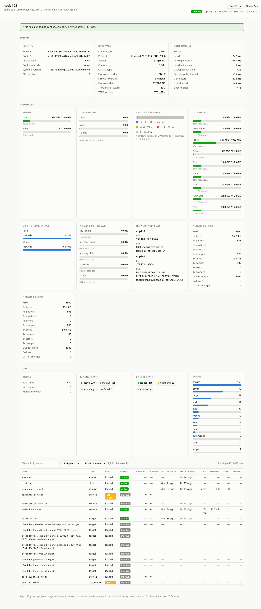
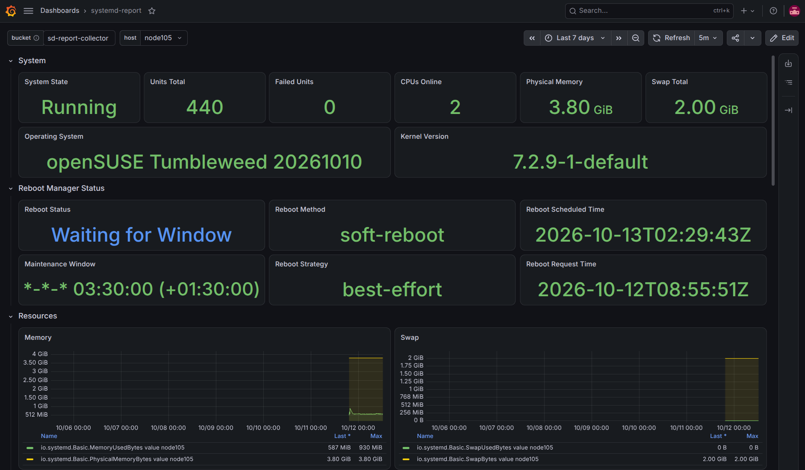
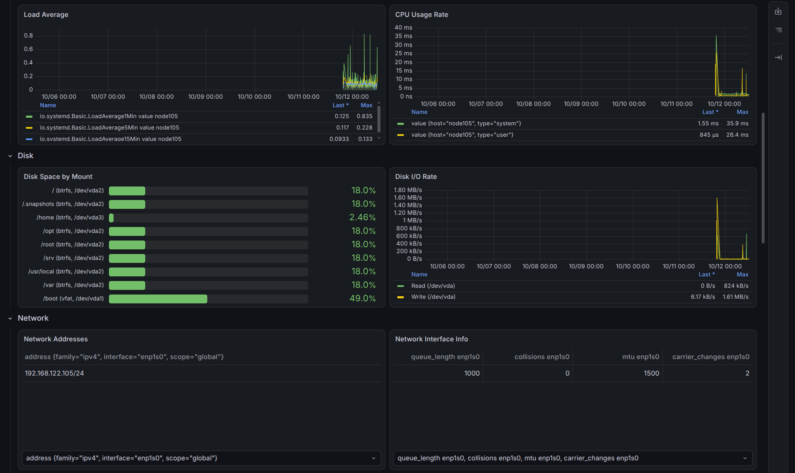
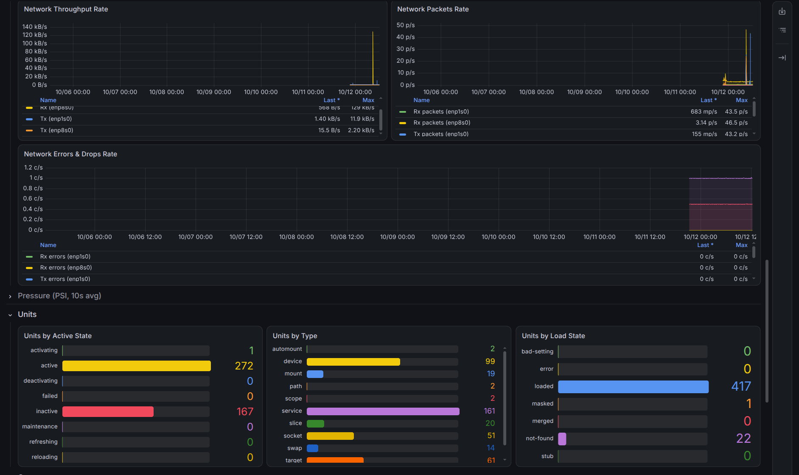

# sd-report-collector

Server counterpart to `systemd-report upload`
(see [systemd-report](https://manpages.opensuse.org/systemd-report.1)).
Accepts report pushes over mTLS, stores each one zstd-compressed under a
per-hostname directory, and runs configured plugins against the saved file.

## Build

Requires `libeconf` development headers (`libeconf-devel` / `libeconf-dev`)
and a C compiler, since configuration parsing uses cgo bindings to libeconf.

```
meson setup build
meson compile -C build
meson test -C build
```

## Quickstart

### Server

Generate the CA, server cert, and a client cert under /etc/sd-report-collector and start the service:

```sh
sd-report-certs init
sd-report-certs client myhost.example.com

systemctl start sd-report-collector.service
```

### Client

Call `systemd-report` manual:

```sh
/usr/lib/systemd/systemd-report upload --url=https://<server>:8443/report --cert=/etc/sd-report-collector/clients/myhost.pem --key=/etc/sd-report-collector/clients/myhost.key --trust=/etc/sd-report-collector/ca.pem
```

Or use the provided timer and service file to run `systemd-report` regular.
The steps on the client:

```sh
mkdir -p /etc/sd-report-collector/clients/

cp myhost.example.com.{key,pem} /etc/sd-report-collector/clients/
cp ca.pem /etc/sd-report-collector

echo "REPORT_SERVER=<server hostname>" > /etc/default/sd-report-collector
systemctl enable --now sd-report-collector-node.timer
```

## Configuration

See `dist/sd-report-collector.conf` for all keys and their defaults.

## Certificate management

`sd-report-certs` generates the CA, server certificate, and client
certificates needed for mTLS, storing everything below
`/etc/sd-report-collector`:

```
sd-report-certs init          # generates ca.pem/ca.key and server.pem/server.key
sd-report-certs client myhost # generates clients/myhost.pem and clients/myhost.key,
                              # signed by the CA from init
```

`init` must be run once (as root, since it writes under `/etc`) before any
`client` certificates can be issued. Both subcommands refuse to overwrite
existing files unless `--force` is given; forcing `init` invalidates every
certificate previously signed by that CA. `init` also writes
`sd-report-collector.conf.d/certgen.conf`, a config drop-in pointing
`ServerCertificateFile`, `ServerKeyFile`, and `ClientCAFile` at the generated
`server.pem`/`server.key`/`ca.pem`.
Each `clients/<name>.pem`/`clients/<name>.key` pair needs to be copied to
the matching client (`myhost` here matches the hostname systemd-report will
report as).

## Verifying signed reports

`systemd-report upload --sign=` (see `systemd-report-sign-plain(8)`) signs
each report with a self-generated Ed25519 host key and emits it as a
JSON-SEQ stream: the report record, followed by a signature record. The
report record itself also embeds the public key, as the
`io.systemd.Report.SignPlain.PublicKey` metric. sd-report-collector always
checks that both copies of the key (embedded in the report, attached to the
signature) match and that the signature verifies against them; a mismatch or
bad signature quarantines the report under `QuarantineDirectory` as before
and logs it as a critical error.

On its own, that only proves the report wasn't altered after signing — not
that the key belongs to the host it claims to be from, since the key is
self-generated and travels in the same payload it signs. Anyone who can
reach the endpoint could mint their own keypair and "sign" a forged report
for any hostname. To turn verification into an actual identity check,
sd-report-collector pins each host to a key using three tiers, checked in
order:

1. **Trusted** — a key file exists at
   `TrustedKeysDirectory/<hostname>.pem`. This directory is meant to be
   populated by the administrator, by copying the public key off the client
   machine over a channel independent of the report upload path (e.g.
   during provisioning, alongside the mTLS client certificate). This is the
   only tier that authenticates the sender: an attacker who doesn't control
   that out-of-band channel cannot make the server accept a different key
   for that hostname, no matter what it attaches to a forged report.
2. **Known** — no trusted key exists, but a key was already learned from an
   earlier report under `KnownKeysDirectory/<hostname>.pem`. The new
   report's key must match it exactly; a mismatch is treated as a possible
   key rotation or spoofing attempt and the report is quarantined.
3. **First seen** — no key exists in either directory yet. The report's own
   key is accepted trust-on-first-use and saved to
   `KnownKeysDirectory/<hostname>.pem` for next time.

Tiers 2 and 3 never see an out-of-band comparison, so they only provide
continuity (the same key signed every report "so far"), not real sender
authentication — the gap they can't close is a forged report arriving
*before* the genuine host's first report. Populate `TrustedKeysDirectory`
for hosts where that gap matters.

Each plugin (see below) is invoked with a new first argument, the
verification outcome for the report it's about to process: `unsigned`,
`trusted`, `known`, or `first-seen`.

## Dashboard plugin

`sd-report-dashboard` is an sd-report-collector plugin that renders a saved
report as a static, self-contained HTML dashboard. Point a `[Plugins]` entry
at the built binary:

```
[Plugins]
dashboard=/usr/lib/sd-report-collector/sd-report-dashboard
```

It writes `<OutputDirectory>/<hostname>.html`, overwriting that host's
dashboard in place each time a new report arrives. The HTML template is
compiled into the binary, but can be overriden via a snippet in
`/etc/sd-report-collector/sd-report-collector.conf.d/`:

```
[Dashboard]
OutputDirectory=/srv/www/html/dashboards
TemplateFile=/etc/sd-report-dashboard/dashboard_template.html
DescribeFile=/etc/sd-report-dashboard/report.describe
```

`TemplateFile` and `DescribeFile` are optional; leaving them unset uses the
built-in template and omits per-metric type/description annotations,
respectively. `DescribeFile` should point at the output of
`systemd-report describe`.

The dashboard header shows a badge for the report's sign-status (the first
argument sd-report-collector invokes this plugin with, see "Verifying signed
reports" above): green "trusted" for a report verified against an
administrator-provisioned key, yellow/orange for a self-signed report merely
verified against a key learned from earlier reports ("known"/"first seen"),
or a muted "Unsigned" badge if the report carried no signature at all.
Hovering the badge explains what that tier does and doesn't prove.



## InfluxDB plugin and Grafana dashboard

`sd-report-influxdb` is an sd-report-collector plugin that exports a saved
report's metrics to InfluxDB, so they can be graphed over time in Grafana.
Point a `[Plugins]` entry at the built binary:

```
[Plugins]
influxdb=/usr/lib/sd-report-collector/sd-report-influxdb
```

and configure the InfluxDB server to write to:

```
[InfluxDB]
Server=influxdb.example.com
Bucket=sd-report-collector
Organization=my-org
Token=<token>
```

`Token` can also be supplied via the `INFLUXDB_TOKEN` environment variable
instead of the config file. See `dist/sd-report-collector.conf` for all keys
and their defaults.

Each metric family becomes an InfluxDB measurement (e.g.
`io.systemd.Basic.LoadAverage1Min`), with its value written to a single
`value` field. The report's hostname, its sign-status (`sign_status`: the
same `unsigned`/`trusted`/`known`/`first-seen` value shown on the dashboard,
see "Verifying signed reports" above), and the metric's `object` (if any,
e.g. a unit name, mount point, or device) and label fields (e.g. `type`,
`resource`, `source`) become tags. The report's own report ID is
intentionally not stored, since it is unique per upload and would otherwise
explode series cardinality.

Metric families can be excluded from export with `ExcludeMetrics`, a
comma-separated list of patterns matched against the family name, e.g.:

```
[InfluxDB]
ExcludeMetrics=io.systemd.Manager.*,io.systemd.Basic.CPUUsage
```

A pattern ending in `*` excludes every family with that prefix (here, the
whole `io.systemd.Manager` family, covering per-unit timestamps and state
noise most dashboards don't need); any other pattern must match a family
name exactly.

[grafana-systemd-report-dashboard.json](dist/grafana-systemd-report-dashboard.json)
is a ready-to-import Grafana dashboard built around that layout, covering
the same ground as the HTML dashboard above:
system identity and reboot status, memory/swap/load/CPU/pressure over time,
disk space and I/O, and unit counts by state, type, and load state. Import it
via Grafana's "Import dashboard" screen, pick an InfluxDB datasource
configured with Flux as its query language, and set the `bucket` dashboard
variable to match `[InfluxDB] Bucket` above (it defaults to
`sd-report-collector`). The `host` variable then lists the hosts found in
that bucket.





## Todo

* Verify the report signature
  * ~~by the collector before writing to disk~~ (done: signed reports that
    fail verification are logged as a critical error and saved under
    `QuarantineDirectory` instead of the normal per-host store)
  * ~~pin per-host keys instead of trusting whatever key a report
    attaches~~ (done: `TrustedKeysDirectory` / `KnownKeysDirectory`, see
    "Verifying signed reports" above)
  * ~~by the plugin and add result to html output~~ (done: the dashboard
    header shows a badge for the sign-status argument)
